# 🐜 Ameisenreich

**Ein Lern- und Aufbauspiel für die 4. Klasse.** Du bist die Ameisenkönigin und baust einen ganzen Ameisenstaat auf: tief unter der Erde und oben im Ameisenhügel. Baupläne gibt es nur für **Wissen**: In der **Schule** folgst du einem echten Stundenplan, wählst im aktuellen Fach ein Thema und schreibst Tests zum Stoff der 4. Klasse (Bildungsplan Baden-Württemberg). Wer alle Fragen eines Tests richtig hat, schaltet einen Bauplan frei. In der **Denksport-Halle** übst du Konzentration und Reaktion.

### ▶️ [Jetzt im Browser spielen](https://deep2universe.github.io/rankenzoo/)

Keine Installation und kein Konto nötig – einfach den Link öffnen. Der Spielstand bleibt im Browser gespeichert.

## Screenshots

Zum Aufklappen auf eine Zeile klicken.

<details>
<summary>🏠 <b>Startbildschirm, Nest & Ameisen-Beobachtung</b></summary>

<br>

**Startbildschirm:** Name, Name des Ameisenstaates und Lernmodus wählen.

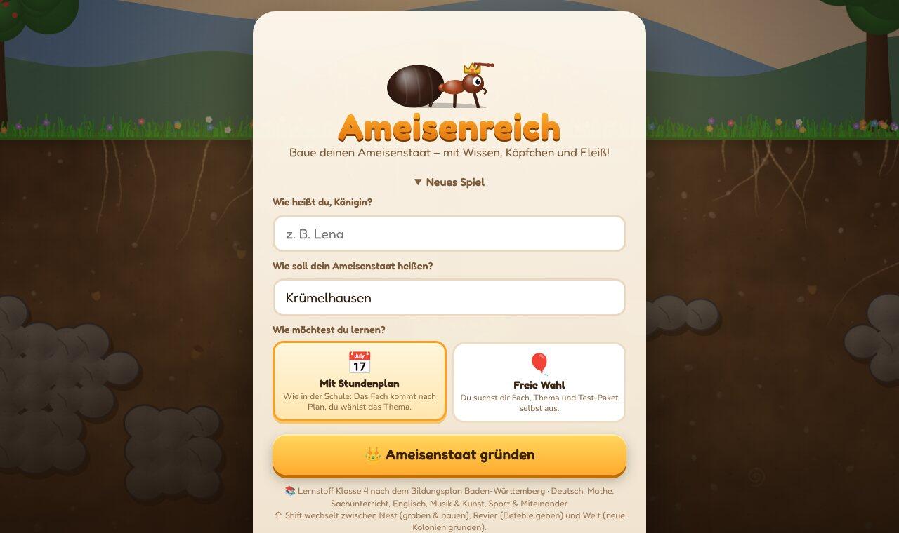

**Das Nest (Seitenansicht):** Kammern unter der Erde, der Ameisenhügel darüber. Links Zufriedenheit und Volk, unten die Bauleiste, rechts Schule und Denksport.

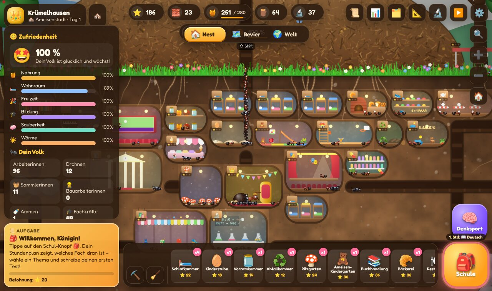

**Ameisen-Beobachtung (Taste B):** Jede Ameise hat einen Steckbrief mit Name, Vorhaben, Zuhause, Freundinnen und Freunden.

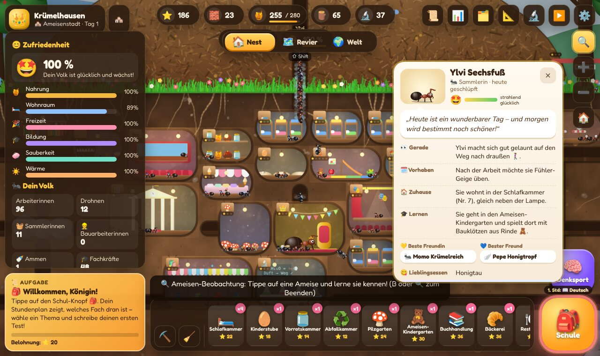

</details>

<details>
<summary>🗺️ <b>Revier, Weltkarte & Holo-HUD</b></summary>

<br>

**Revier (Draufsicht, Shift):** Sammel-Trupps laufen über Duftstraßen zu Beerensträuchern, Blüten und Zweig-Haufen.

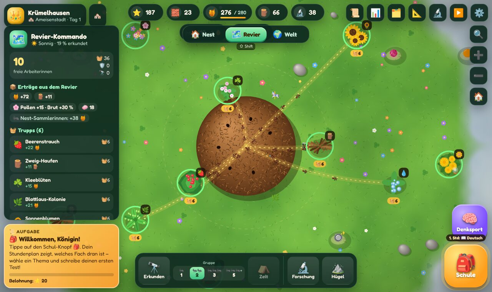

**Weltkarte (Shift):** Das Heimatnest im Garten und die Orte für neue Kolonien.

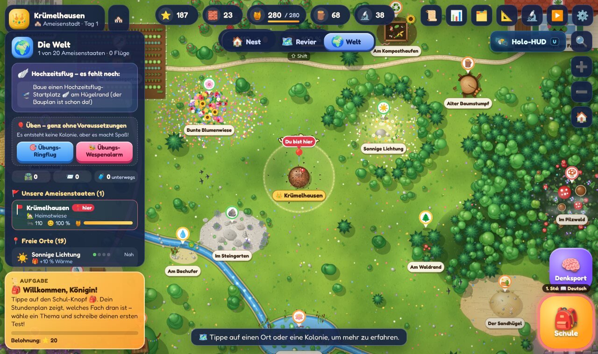

**Holo-HUD (Taste U):** Zivilisationen, Netzwerk, Krabbelschow-Skala, Duftstoffe und Entwicklung auf einen Blick.

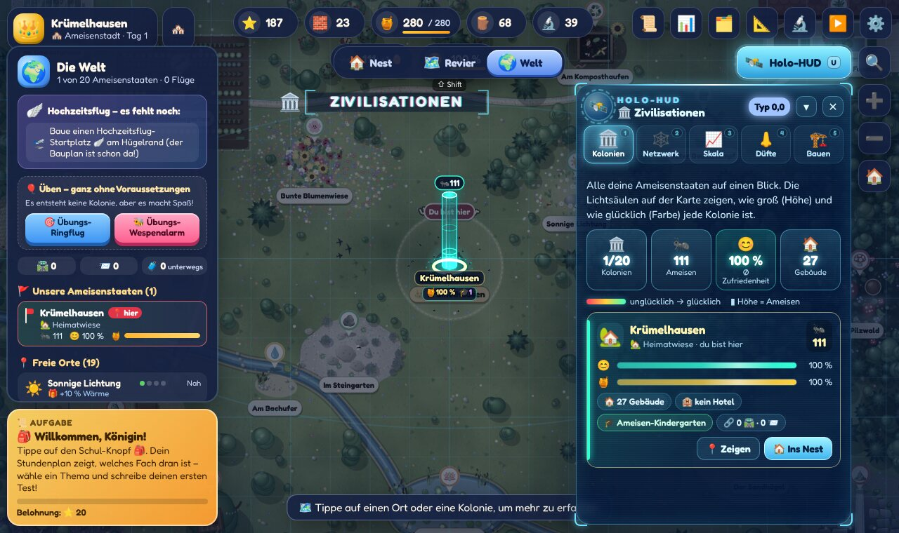

</details>

<details>
<summary>🪽 <b>Hochzeitsflug: Ringflug & Wespenalarm</b></summary>

<br>

**Ringflug:** Die junge Königin fliegt durch goldene Ringe zum Zielort.

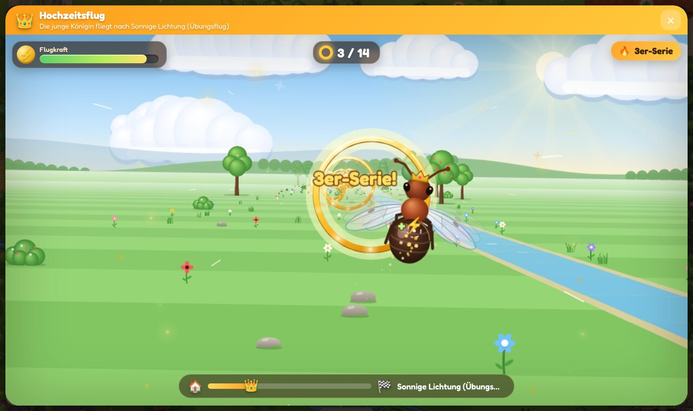

**Wespenalarm:** Wespen ausweichen, Power-up-Blüten sammeln und die Wespen mit Nektar „freundlich verscheuchen".

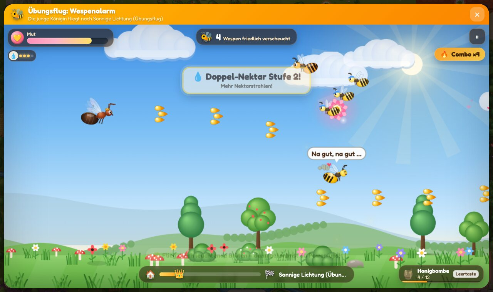

</details>

<details>
<summary>🎒 <b>Schule: Stundenplan, Themen & Tests</b></summary>

<br>

**Stundenplan:** Das Fach der aktuellen Stunde ist vorgegeben.

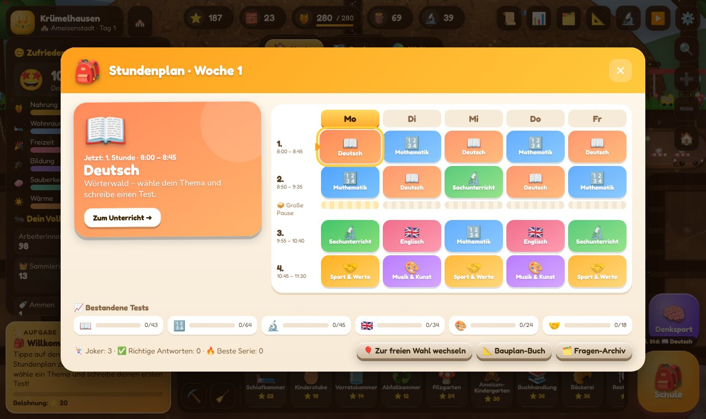

**Themen wählen:** Jede Karte zeigt, welcher Bauplan zu gewinnen ist.

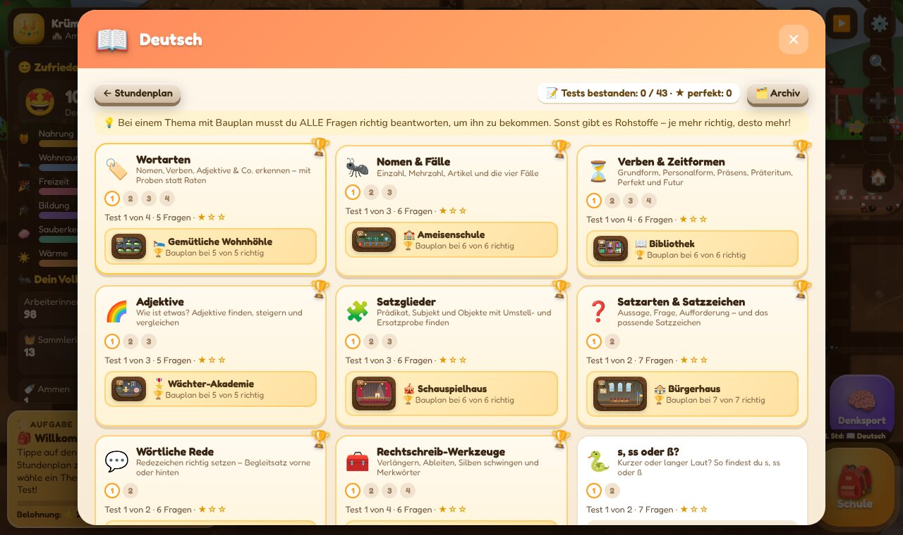

**Test-Vorschau:** Belohnungs-Leiter und Hauptgewinn vor dem Start.

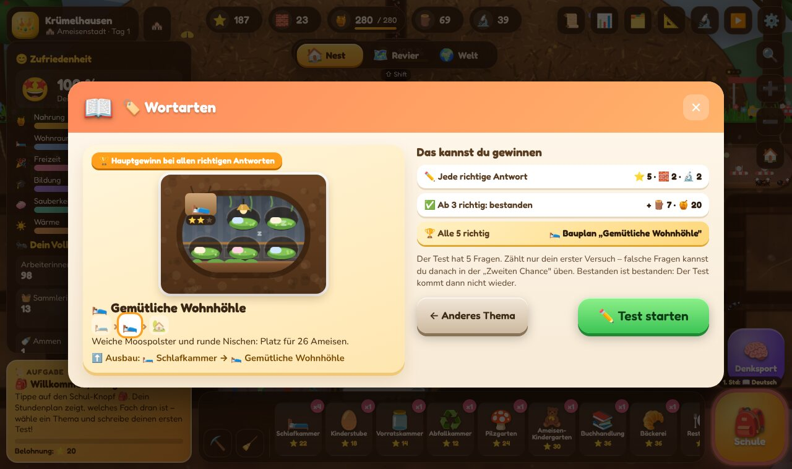

**Eine Frage im Test:** mit Vorlesen 🔊, Jokern und Fortschrittsanzeige.

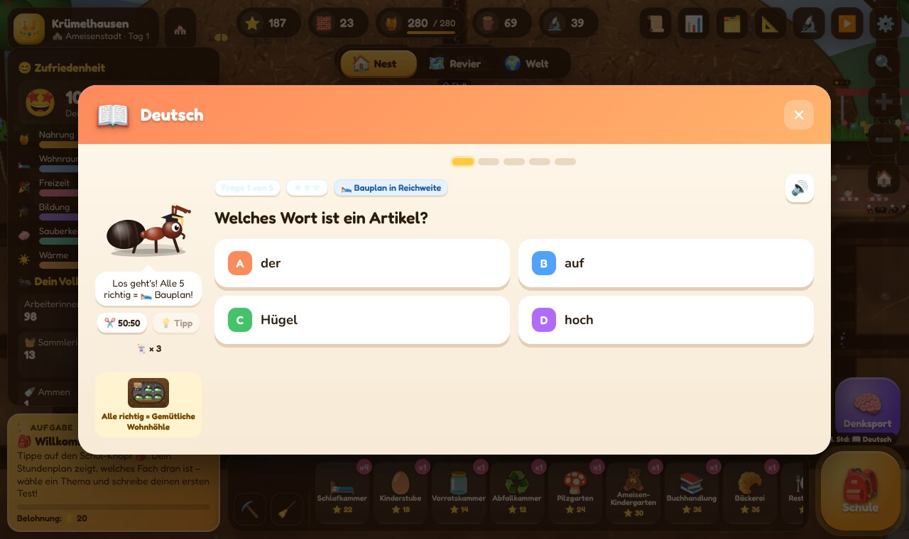

</details>

<details>
<summary>📐 <b>Bauplan-Buch & Denksport-Halle</b></summary>

<br>

**Bauplan-Buch:** Alle Entwicklungslinien, z. B. Ameisen-Kindergarten → Schule → Berufsschule → Gymnasium → Universität.

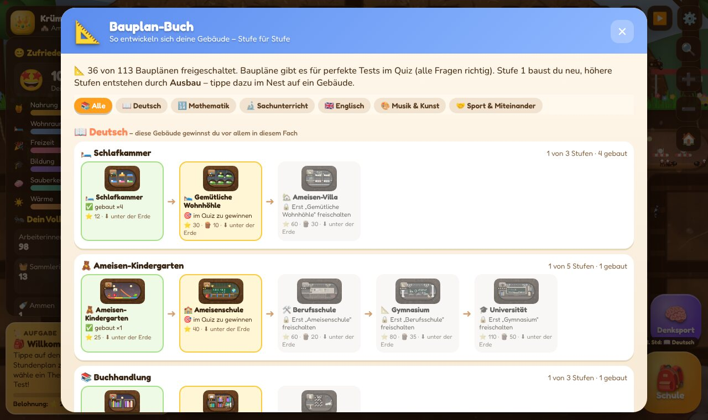

**Denksport-Halle:** 10 Minispiele für Konzentration, Gedächtnis und Reaktion.

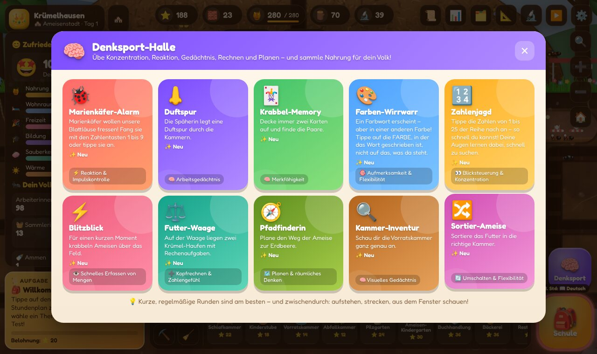

**Marienkäfer-Alarm:** eines der Minispiele (Zifferntasten 1–9).

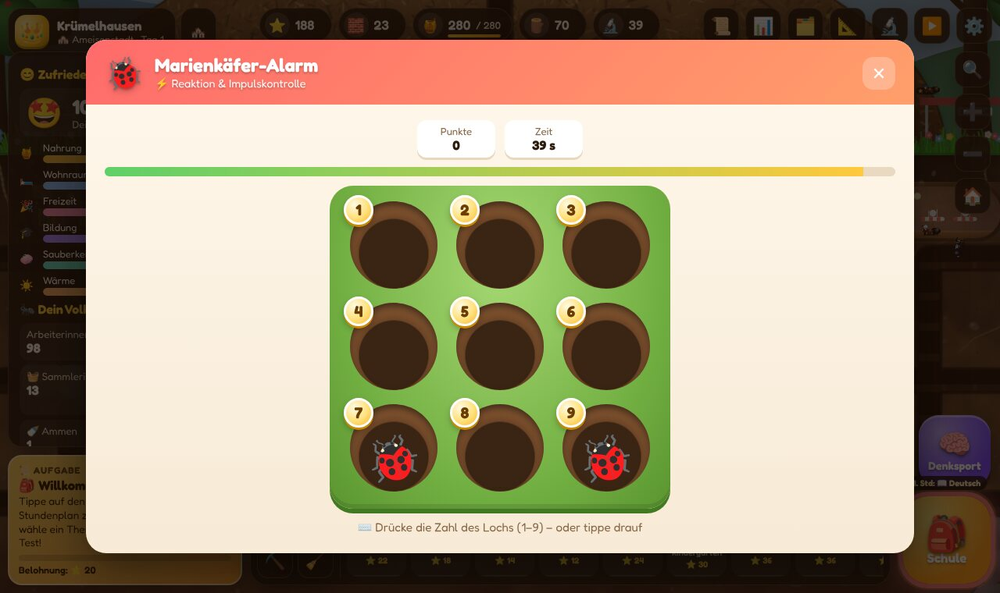

</details>

## Starten

**Online:** Das Spiel läuft auf GitHub Pages: **https://deep2universe.github.io/rankenzoo/**

**Lokal:** Das Spiel läuft komplett im Browser, ohne Installation und ohne Build-Schritt. Weil es ES-Module nutzt, muss es über einen kleinen Webserver geöffnet werden (direkt per Doppelklick auf `index.html` geht es nicht):

```bash
npm start
```

Danach im Browser **http://localhost:8080** öffnen. Alternativ geht jeder andere statische Webserver, zum Beispiel `python3 -m http.server`.

Tests:

```bash
npm test
```

`npm test` prüft das Schema der Fragenbanken und führt Tests für Quiz-Engine, Generatoren, Simulation, die Strategie-Ebene (Revier, Forschung, Handel, alle Gebäude) sowie Stundenplan, Tests, Bauplan-Vergabe, Ausbau, Zelte, Bürgerinnen, Welt sowie mehrere Kolonien, Speichern, Straßen, Hotels, Krabbelschow-Skala und freie Wahl aus.

Entwickler-Seiten (über den Server öffnen): `tools/raeume-galerie.html` (alle Gebäude & Ausbaustufen), `tools/flug-test.html` (Ringflug), `tools/wespenalarm-test.html` (Wespenalarm mit Szenarien), `tools/welt-test.html` (Weltkarte), `tools/holo-test.html` (Holo-HUD), `tools/biome-galerie.html` (alle 20 Gegenden).

## Was steckt drin?

- **Zwei Lernmodi (Wahl beim Spielstart, jederzeit änderbar):** 📅 **Mit Stundenplan** oder 🎈 **Freie Wahl** – dann sucht sich das Kind Fach, Thema und Test-Paket selbst aus. Die möglichen Gewinne (Baupläne mit Gebäudebild oder Rohstoffe) sind in beiden Modi vorab sichtbar; gewonnene Baupläne bleiben immer erhalten.
- **Schule mit Stundenplan 🎒:**
  - Eine Schulwoche (Mo–Fr, je 4 Stunden): Deutsch 5, Mathe 5, Sachunterricht 3, Sport & Miteinander 3, Englisch 2, Musik & Kunst 2 Stunden. Das Fach der aktuellen Stunde ist vorgegeben, das **Thema wählt das Kind selbst**.
  - Jedes Thema ist in feste **Tests** (ca. 6 Fragen) aufgeteilt, vom leichten Test 1 bis zum kniffligen letzten Test – insgesamt 228 Tests. **Bestandene Tests kommen nicht wieder** (ab der Hälfte richtig). Nicht bestandene Tests warten auf die nächste Stunde des Fachs.
  - **Vorher sichtbar, was es zu gewinnen gibt:** Jede Themenkarte zeigt den Bauplan (mit gezeichnetem Gebäude) oder die Rohstoffe. Die Test-Vorschau zeigt eine Belohnungs-Leiter: je richtige Antwort ⭐ 🧱 🔬, ab der Hälfte 🪵 🍯, bei allen richtig den **Bauplan**.
  - **Baupläne nur bei einem perfekten Test.** Sonst gibt es Rohstoffe, abhängig von der Zahl richtiger Antworten. Es gibt mehr Tests als Baupläne – sind alle Baupläne vergeben, verteilen die Tests nur noch Rohstoffe (bei perfekten Tests einen Schatz-Bonus).
  - Nach vier Stunden ist **Schulschluss**; der nächste Schultag beginnt mit dem nächsten Ameisentag.
  - Das **Fragen-Archiv** zeigt weiterhin alle Fragen mit richtiger Antwort und Erklärung.
- **Gebäude, die sich entwickeln (110 Baupläne in 36 Entwicklungslinien):**
  - Beispiel Bildung: Kindergarten → Schule → Berufsschule → Gymnasium → Universität. Ähnlich für alle Gebäude, z. B. Schlafkammer → Wohnhöhle → Ameisen-Villa, Pilzgarten → Pilzplantage → Pilz-Gewächshaus, Kino → Großkino → Filmpalast, Königinnenkammer → Thronsaal → Kronjuwelen-Palast.
  - Stufe 1 wird neu gebaut, höhere Stufen entstehen durch **Ausbau** an Ort und Stelle (Gebäude antippen → „Ausbauen"); das Gebäude arbeitet während des Ausbaus weiter. Jede Stufe wirkt stärker.
  - Baupläne sind **dauerhaft freigeschaltet**: Gebaut wird mit Sternen und Baumaterial, jedes weitere Gebäude der gleichen Art kostet etwas mehr.
  - Die Quiz-Entwicklung spiegelt die Gebäude-Entwicklung: niedrige Stufen liegen auf leichten Tests, Gymnasium und Universität erst auf schwierigen. Jede Linie gehört zu einem Fach (Bildung → Deutsch, Labor → Mathe, Pilzgarten → Sachunterricht …).
  - Das **Bauplan-Buch 📐** zeigt alle Linien mit Bildern: freigeschaltet, im Quiz zu gewinnen oder noch gesperrt (mit Grund).
- **Ameisen-Beobachtung 🔍 (Taste B):** Jede Ameise ist eine Persönlichkeit. Ein Tipp zeigt ihren Steckbrief: Name, Wohlbefinden, was sie gerade tut und vorhat, beste Freundin und bester Freund, wo sie wohnt, ob sie in den Kindergarten, die Schule oder die Universität geht, Lieblingsessen, Traum und Erlebnisse. Alle Aussagen sind positiv und zukunftsfroh. Mit „Folgen" begleitet die Kamera die Ameise.

- **Drei Ansichten, ein Spiel – Shift ⇧ wechselt Nest → Revier → Welt:**
  - 🏠 **Nest** (Seitenansicht): Gänge graben, Kammern bauen, das Volk versorgen.
  - 🗺️ **Revier** (Draufsicht): die Wiese rund um den Hügel. Hier gibst du den Ameisen **Befehle**: Sammel-Trupps zu Futterquellen schicken, Wächterinnen gegen Störenfriede abstellen, **Expeditionen** in den Nebel senden, Schätze finden, mit einem Nachbarvolk handeln. Wetter und Tageszeit wirken sich aus.
  - 🌍 **Welt** (Übersichtskarte): das Heimatnest mit seinem Revier inmitten des Gartens, dazu 9 Orte für neue Kolonien (Lichtung, Blumenwiese, Bachufer, Waldrand, Baumstumpf, Gemüsegarten, Sandhügel, Spielplatz, Blumentopf).
  - Der Wechsel wird mit einer Iris-Überblendung vom Ameisenhügel aus animiert; die Oberfläche wechselt ihr Farbthema.
- **Viele Ameisenstaaten (bis zu 20):** Jede per Hochzeitsflug gegründete Kolonie ist **voll bebaubar** wie das Heimatnest – Untergrund, Hügel und Wiese, mit eigenem Volk, eigener Nahrung und eigenem Revier. Jede liegt in einer eigenen **Gegend** (Sandhügel, Seerosenteich, Pilzwald, Kornfeld, Blumentopf am Fenster …), die man an Boden, Hügel, Pflanzen und Hintergrund sofort erkennt. Neue Kolonien starten mit einem fertigen Startnest, mitgeflogenen Arbeiterinnen und einem Gründungsbonus, damit es ohne langes Warten weitergeht. Sterne, Baumaterial, Forschung und **Baupläne gelten für alle Kolonien**. Gewechselt wird über 🏘️ oben links oder auf der Weltkarte; ruhende Kolonien wachsen im Hintergrund weiter.
- **Netz zwischen den Kolonien:** 🛣️ **Ameisenstraßen** (Trampelpfad → Ameisenstraße → Duft-Autobahn) gleichen Nahrung aus und bringen Handel; 📨 **Botenlinien** tragen Wissen per Duftpost (mehr 🔬, Quiz-Bonus). Mit **Hotels** (Duft-Gästehaus → Ameisen-Hotel → Grandhotel) kommen Gäste: Studentenaustausch, Nahrungstausch, Duftspur-Konferenzen und Freundschaftsbesuche. So wächst das **kollektive Ameisen-Bewusstsein**.
- **Holo-HUD 🛰️ auf der Weltkarte (Taste U):** eine blaue, holografische Ansicht mit fünf Views – Zivilisationen, Netzwerk & Handel, **Krabbelschow-Skala** (die Kardaschow-Skala für Ameisen: Typ I = bereit für den ersten Hochzeitsflug … Typ V = alle 20 Ameisenstaaten), Duftstoffe und Entwicklung (wo fehlen Hotels, Straßen, Schulen?).
- **Hochzeitsflug als eigenes Spiel 🪽 – in zwei Varianten:** 🎯 **Ringflug** (große Ringe, Wind bleibt spannend) und 🐝 **Wespenalarm** (Wespen ausweichen, mit unendlich Nektar „freundlich zur Aufgabe zwingen", viele Power-up-Blumen schalten neue Nektar-Waffen frei). Der Startplatz-Bauplan ist von Anfang an da, wenige Drohnen genügen; **Übungsflüge** gehen jederzeit.
- **Ablauf des Flugs:** Auf der Weltkarte wählt das Kind ein Ziel. Dann steuert es die junge Königin (Maus, Finger oder Pfeiltasten) durch goldene Ringe zum Zielort. Gefangene Ringe geben Flugkraft, verpasste kosten welche; weite Ziele haben mehr und kleinere Ringe und Windböen. Gelingt der Flug, entsteht dort eine **Tochterkolonie**, die dem Heimatvolk dauerhaft einen Bonus schenkt. Misslingt er, landet die Königin sanft und es kann sofort nochmal versucht werden. Flugfeld und Hochzeitsflughafen machen die Ringe größer.
- **Größeres Revier (64 × 44 Felder):** mit Blumenwiesen 🌸, Löwenzahn 🌼 und Kleeblüten ☘️ – **Pollen** ist eiweißreich und lässt die Brut schneller wachsen –, Pilzkreisen, alten Eichen, einem zweiten Teich mit Bach und **16 Fundstücken** im Nebel (Glasmurmel, Schneckenhaus, Bernstein, Kompass …), die Expeditionen heimbringen und die in einer Sammlung landen.
- **Zelte & Lager ⛺:** Mit dem Bauplan „Expeditions-Zelt" stellt das Kind im erkundeten Revier Zelte auf. Expeditionen starten vom nächsten Lager, Sammel-Wege werden kürzer, fertige Lager lüften den Nebel. Ausbau: Zelt → Basislager → Außenposten (eine Expedition mehr).
- **Aufbau-Strategie:**
  - 36 Grundgebäude (mit Ausbaustufen 110), darunter Sporthalle, Eisladen, Sechs-Bein-Schuhladen, Fühler-Salon, Ameisenschule, Forschungslabor, Theater, Musikschule, Krümelkasse, Tautropfen-Bad, Wachstube, Späherturm, Spielplatz, Handelsposten, Rathaus und Duftspur-Bahnhof.
  - Rohstoffe: Sterne ⭐, Gangstücke 🧱, Nahrung 🍯, **Baumaterial 🪵** (aus dem Revier) und **Forschungspunkte 🔬** (aus Quiz und Bildungsgebäuden).
  - **Forschung & Entwicklung:** 20 Techniken in 5 Ästen (Landwirtschaft, Erkundung, Baukunst, Volk & Brut, Kultur & Wissen), jede mit echtem Ameisen-Fakt.
  - **Arbeitsverteilung:** Bauarbeiterinnen je Baustelle und Ammen-Einsatz einstellbar.
  - Der Ameisenhügel wächst in 6 Stufen.
- **Ein lebendiges Volk:**
  - Königin, Arbeiterinnen, Drohnen und Brut (Ei → Larve → Puppe).
  - Ausgebildete Ameisen mit Berufen und Accessoires (Kochmütze, Doktorhut, Helm, Zylinder …).
  - Sechs Bedürfnisse bestimmen die Zufriedenheit.
  - Ein Hochzeitsflug (Ring-Flugspiel) gründet Tochterkolonien auf der Weltkarte.
- **Wissens-Quiz:**
  - 1 125 kuratierte Fragen in 6 Fächergruppen, dazu unbegrenzt viele Rechen- und Zahlenaufgaben mit Rechenweg.
  - **Bestandene Tests kommen nicht wieder.** Falsch beantwortete Fragen werden direkt in der „Zweiten Chance“ geübt; nicht bestandene Tests warten auf die nächste Stunde.
  - **Fragen-Archiv 🗂️:** alle gestellten Fragen mit Status; die richtige Antwort und Erklärung zeigt eine Tooltip-Karte beim Darüberfahren, ein Klick pinnt sie fest (mit eigenem ✕).
  - Jede richtige Antwort bringt auch Forschungspunkte.
- **Denksport:** 10 Minispiele: Marienkäfer-Alarm (mit Zifferntasten 1–9), Duftspur, Memory, Farben-Wirrwarr, Zahlenjagd, Blitzblick, Futter-Waage, Pfadfinderin, Kammer-Inventur, Sortier-Ameise.
- **Grafik und Ton:**
  - Alles wird prozedural gezeichnet, mit Tag-/Nachtwechsel, Wetter und animierten Kammern.
  - Die Ameisen laufen wirklich durch die Gänge und über die Duftstraßen im Revier.
  - Klänge, Musik und Vorlesen erzeugt der Browser selbst.
- **Sparsam mit Akku und Lüfter:** Sprite-Caches, ein zwischengespeichertes Geländebild, adaptive Bildrate (flüssig beim Scrollen, gemächlich im Ruhezustand, fast still hinter Fenstern) und eine Grafik-Einstellung (Sparsam / Ausgewogen / Hoch).
- **Kindgerecht:** keine Käufe, keine Ranglisten, niemand stirbt (Störenfriede werden nur verscheucht). Nach 25 Minuten erinnert das Spiel an eine Bewegungspause. Der Spielstand wird nur lokal im Browser gespeichert.

## Auf GitHub Pages veröffentlichen

Das Veröffentlichen übernimmt der Workflow [`.github/workflows/pages.yml`](.github/workflows/pages.yml): Bei jedem Push auf `main` laufen die Tests, danach werden `index.html`, `src/` und `styles/` auf GitHub Pages veröffentlicht. Es gibt keinen Build-Schritt und keine Abhängigkeiten.

Einmalig einzurichten:

1. **Repository öffentlich machen** (nur nötig, wenn es privat ist): *Settings → General →* ganz unten *Danger Zone → Change visibility → Make public*. Mit einem kostenlosen GitHub-Konto gibt es GitHub Pages nur für öffentliche Repositories; dort sind Pages und Actions kostenlos.
2. **Pages auf GitHub Actions umstellen:** *Settings → Pages → Build and deployment → Source:* **GitHub Actions**.
3. **Auf `main` bringen** (Pull Request mergen) – oder, falls schon auf `main`: *Actions → GitHub Pages → Run workflow*.

Nach ein bis zwei Minuten ist das Spiel unter `https://<benutzername>.github.io/<repository>/` erreichbar, hier also **https://deep2universe.github.io/rankenzoo/**. Jede spätere Änderung auf `main` wird automatisch veröffentlicht.

## Bedienung

| Taste | Nest | Revier |
|---|---|---|
| ⇧ Shift | ins Revier | zur Welt (dort: zurück ins Nest) |
| Q / M | Schule / Denksport | Schule / Denksport |
| B | Ameisen-Beobachtung | Ameisen-Beobachtung |
| U | – | Welt: Holo-HUD an/aus (1–5 = Views) |
| Z | – | Zelt aufstellen |
| F | Forschung | Forschung |
| G / X | Gang graben / Abriss | – |
| E | – | Expedition: Ziel wählen |
| WASD, Pfeile, Mausrad | Ansicht verschieben / zoomen | Ansicht verschieben / zoomen |
| H | zur Königin | zum Hügel |
| 1–9 | Quiz-Antworten, Marienkäfer-Löcher | |

## Projektstruktur

```
index.html                 Einstieg
styles/main.css            Gestaltung
src/main.js                Spielsteuerung & Hauptschleife
src/game/                  Konfiguration & Entwicklungslinien, Welt/Gitter, Simulation, Aktionen, Aufgaben, Spielstand,
                           Revier & Lager (revier.js), Forschung, Baupläne & Ausbau (bauplaene.js),
                           Weltkarte & Orte (welt.js), Gegenden (biome.js), mehrere Kolonien (kolonien.js),
                           Netz, Besuche, Krabbelschow-Skala, Duftkarte (zivilisation.js), Bürgerinnen (buerger.js)
src/render/                Canvas-Renderer: Gelände, Kammern, Ameisen, Himmel, Revier-Karte, Sprite-Caches
src/ui/                    Oberfläche: HUD, Schule/Quiz, Bauplan-Buch, Ameisen-Karte, Hochzeitsflug, Welt, Revier, …
src/quiz/                  Quiz-Engine, Aufgaben-Generatoren, Stundenplan & Tests (stundenplan.js)
src/data/questions/        Fragenbanken je Fach (+ SCHEMA.md)
tools/                     Server, Validator, Smoke-Test, Strategie-Test
docs/screenshots/          Bilder für diese README
.github/workflows/         Tests & Veröffentlichung auf GitHub Pages
_agent_doc/                Recherche zum Lehrplan & Spieldesign
```

## Dokumentation

- [Lernplan-Recherche Klasse 4 (BW)](_agent_doc/01_lernplan_research_klasse_4/00_README.md)
- [Fragesystem-Design](_agent_doc/01_lernplan_research_klasse_4/09_fragesystem_design.md)
- [Spieldesign](_agent_doc/02_spieldesign.md)
- [Schema für neue Fragen](src/data/questions/SCHEMA.md)
